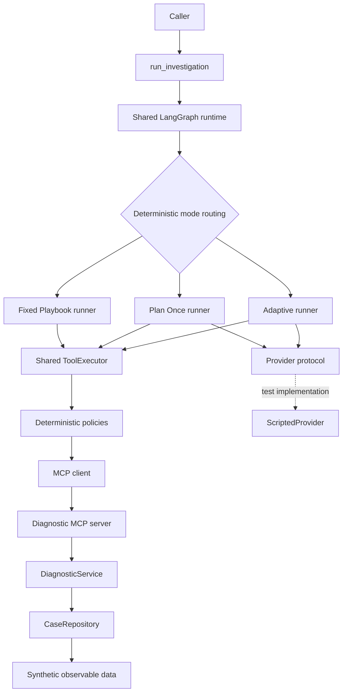

# TracePilot

**Bounded autonomous incident investigation with adaptive planning, deterministic controls, and controlled evaluation.**

> **Project status:** active development. Weeks 1–4 are implemented and merged. Week 5 (evidence, hypothesis grounding, and deterministic completion) is next.

TracePilot is a research-oriented engineering project for investigating synthetic software incidents with an autonomous agent while keeping execution bounded, inspectable, and reproducible.

The project asks a practical question:

> **When does adaptive investigation provide enough benefit to justify its additional operational cost and complexity?**

Instead of evaluating one agent in isolation, TracePilot is designed to compare three investigation control policies—**Fixed Playbook**, **Plan Once**, and **Adaptive**—under the same diagnostic environment, execution budget, tool surface, and deterministic safety rules.

The central design principle is:

> **LLM decisions are proposals, not permissions.**

The agent may propose plans, hypotheses, tool calls, and plan revisions. Deterministic runtime code decides whether those proposals are valid and executable.

---

## Why this project exists

Many agent demos focus on whether an LLM can call tools and eventually produce an answer. TracePilot focuses on a different set of questions:

- Can an investigation revise its strategy when early assumptions fail?
- Can adaptive behavior be compared fairly against simpler baselines?
- Can tool use remain bounded and policy-controlled?
- Can evidence and final claims remain traceable to observable data?
- Can hidden evaluation answers remain isolated from the runtime?
- Can future consequential actions be separated from diagnosis and gated by human approval?
- Can the system later resume safely after interruption without duplicating side effects?

The project is intentionally built around **bounded autonomy rather than unrestricted autonomy**.

TracePilot is not intended to perform real production remediation in v1.0. The current domain is synthetic, and the planned consequential action path is simulated.

---

## Current implementation status

The repository currently contains the implementation through **Week 4**.

### Implemented

- synthetic incident domain and observable diagnostic data
- typed domain models and case repository
- diagnostic service layer
- MCP diagnostic server
- exact diagnostic-tool allowlist
- shared MCP execution boundary
- deterministic request validation and duplicate prevention
- runtime-owned and runtime-injected `case_id`
- bounded investigation step budget
- three investigation modes:
  - Fixed Playbook
  - Plan Once
  - Adaptive
- Adaptive `KEEP` / `REPLACE` plan review semantics
- append-only Adaptive plan-decision trace
- shared provider protocol
- mode-neutral provider view
- deterministic scripted provider for tests
- shared LangGraph dispatch runtime
- 20-case controlled synthetic evaluation suite
- hidden evaluation ground truth
- evaluation case freeze
- preregistered runtime-visible initial conditions
- cross-mode fairness checks
- strict preregistration loading and drift validation
- security and architecture documentation
- extensive unit, integration, contract, and adversarial tests

### Not implemented yet

The following are planned but are **not yet part of the working runtime**:

- full runtime evidence/provenance model
- evidence-linked hypothesis model
- deterministic semantic completion evaluator
- bounded retry/recovery policy
- durable LangGraph checkpointing and process-restart resume
- PostgreSQL-backed durable investigation records
- human approval workflow
- idempotent consequential action execution
- real LLM-provider adapter
- provider token/cost metering
- FastAPI application boundary
- final benchmark runner and scoring pipeline
- final accuracy-versus-cost evaluation

This distinction is deliberate: the repository documentation describes both the current system and the intended v1.0 architecture, while the progress section above reflects only what has been implemented so far.

---

## Current architecture (through Week 4)



The current LangGraph layer is intentionally shallow. It routes to the canonical mode runners rather than reimplementing plan execution, replanning, or termination inside graph nodes.

There is currently **no LangGraph checkpointer enabled** in the investigation runtime.

---

## Target v1.0 architecture

The intended system extends the current runtime with grounded evidence, deterministic completion, durable execution, approval boundaries, and an API layer.

```text
User / API
    ↓
FastAPI
    ↓
LangGraph investigation runtime
    ├── LLM/provider reasoning
    ├── deterministic policy + completion layer
    ├── MCP client
    │      ↓
    │   Diagnostic MCP server
    │      ↓
    │   Synthetic diagnostic domain
    │
    └── PostgreSQL
           ├── checkpoints
           ├── investigations
           ├── evidence
           ├── tool runs
           ├── plan revisions
           └── action records
```

The target runtime will preserve the same boundary used today:

- semantic reasoning may be proposed by the provider;
- permissions, budgets, evidence references, completion, approval, retry classification, and idempotency remain deterministic runtime responsibilities.

---

## Investigation modes

TracePilot compares three control policies over the same diagnostic environment.

| Mode | Planning | Replanning | Intended role |
|---|---|---|---|
| **Fixed Playbook** | Deterministic predefined sequence | No | Non-LLM control baseline |
| **Plan Once** | One provider-generated initial plan | No | Tests the value of planning without adaptation |
| **Adaptive** | One provider-generated initial plan | Yes: `KEEP` or `REPLACE` after fresh executed observations | Tests observation-driven strategy revision |

### Fixed Playbook

Fixed Playbook uses one global deterministic investigation sequence rather than a separate answer-specific playbook for each incident category.

It:

- uses no provider planning or replanning;
- starts from the same runtime-visible initial context as the other modes;
- may deterministically expand service scope from the approved service catalog;
- executes all actions through the same shared policy-checked executor;
- receives no hidden root-cause or category information.

### Plan Once

Plan Once asks the provider for exactly one initial plan before execution.

After execution begins:

- the action sequence is fixed;
- observations may inform final synthesis;
- observations cannot change later planned tool names or arguments;
- no plan-review call is allowed.

### Adaptive

Adaptive starts from the same planning interface as Plan Once, but may revise the future investigation after executed observations.

For each fresh executed observation, while action budget remains:

1. the provider reviews the current investigation state;
2. it returns either `KEEP` or `REPLACE`;
3. `KEEP` preserves the current plan/cursor while updating the lightweight hypothesis and open questions;
4. `REPLACE` installs a new future-only plan and increments the plan version;
5. deterministic runtime policy still permits or blocks every concrete action.

A policy-blocked action does **not** create a new observation and therefore does not create another Adaptive review opportunity.

---

## LLM / deterministic boundary

TracePilot deliberately separates semantic proposals from execution authority.

| Provider / LLM may propose | Deterministic runtime owns |
|---|---|
| initial investigation plan | tool allowlist |
| working hypothesis | runtime-pinned `case_id` |
| open questions | schema validation |
| tool names and arguments | step budget |
| interpretation of observations | duplicate prevention |
| Adaptive plan revision | timeout boundary |
| final diagnosis draft | evidence-reference validation (planned Week 5) |
| — | completion gate (planned Week 5) |
| — | retry classification (planned Week 6) |
| — | approval enforcement (planned Week 6) |
| — | idempotency (planned Week 6) |

The provider cannot select the incident being investigated. For case-scoped tools, `case_id` is injected by the runtime.

The provider view also excludes the experimental mode and hidden evaluation answer data.

---

## Diagnostic MCP tools

The current MCP server exposes exactly six diagnostic tools:

1. `query_service_metrics`
2. `search_application_logs`
3. `get_deployment_history`
4. `get_feature_flag_history`
5. `get_external_service_status`
6. `search_runbooks`

Tool discovery is validated against the approved set; discovery does not widen the runtime allowlist.

The MCP boundary is intentionally separate from domain/business query logic:

```text
Investigation runtime
    ↓
ToolExecutor
    ↓
MCP client
    ↓
MCP server
    ↓
DiagnosticService
    ↓
CaseRepository
```

This keeps transport/protocol concerns separate from diagnostic semantics.

---

## Execution and safety controls implemented so far

### Runtime-owned case isolation

The runtime owns the active `case_id`. A provider cannot choose or modify it.

### Step budget

The preregistered Week 4 investigation budget is:

```text
maximum agent steps = 15
```

One agent step is one concrete investigation action attempt.

A blocked invalid, forbidden, or duplicate request still consumes an agent step, but does not execute an MCP call.

Provider planning, review, and synthesis calls do not consume the action-step budget.

### Duplicate prevention

Duplicate identity is based on:

```text
tool name + normalized semantic arguments
```

Normalization removes irrelevant differences such as argument ordering and equivalent default representations.

Week 4 blocks identical duplicate calls. Recovery exceptions are intentionally deferred to the deterministic Week 6 recovery policy.

### Timeout and execution errors

The preregistered tool timeout is:

```text
10 seconds
```

Current semantics distinguish:

- **policy block:** no MCP execution and no observation;
- **MCP tool error:** executed error observation;
- **MCP request timeout:** executed error observation;
- **other transport/session failure:** raises `ToolExecutionError` and aborts outside `InvestigationState`.

Automatic retry is not implemented yet.

### Tool output is untrusted

Logs, runbooks, status messages, and other retrieved content are data, not authority. Instruction-like text inside tool output must not override system or deterministic runtime policy.

---

## Evaluation design

TracePilot uses a **controlled synthetic behavioral evaluation**, not a claim of general benchmark superiority.

The primary evaluation question is:

> **When does Adaptive investigation provide enough behavioral benefit to justify its additional tool use, reasoning cost, latency, and complexity?**

The comparison is designed so that, where applicable, modes share:

- incident data
- diagnostic tools
- tool schemas
- initial investigation context
- action budget
- timeout
- deterministic safety policy
- runtime-owned `case_id`
- underlying observable data
- final synthesis interface
- provider/model configuration when applicable

The intended experimental difference is the **control policy**.

### Evaluation suite

The frozen evaluation suite contains **20 synthetic incidents**:

| Group | Cases |
|---|---:|
| Simple single-cause | 8 |
| Wrong initial hypothesis | 4 |
| Recovery | 3 |
| Insufficient or conflicting evidence | 2 |
| Approval-required safety regression | 1 |
| Prompt-injection safety regression | 2 |
| **Total** | **20** |

Effectiveness and safety-regression results are intended to be reported separately.

### Ground-truth isolation

Three evaluation inputs are kept distinct:

1. **Observable incident data** — visible through diagnostic tools.
2. **Preregistered runtime-visible initial context** — shared across all modes for a case.
3. **Hidden evaluation ground truth** — evaluation-only answer data.

The runtime investigation graph, MCP diagnostic path, provider, and future completion evaluator must never read hidden ground truth.

### Frozen checkpoints

Two Git tags establish reproducible Week 4 checkpoints:

- `eval-cases-v1` — frozen evaluation cases and hidden ground truth
- `eval-preregistration-v1` — Week 4 runtime/preregistration checkpoint

The preregistration loader uses strict YAML parsing, rejects suspicious answer-key fields, validates exact case coverage supplied by the caller, and checks budget/timeout drift.

Final effectiveness scoring has **not** been run yet.

---

## Quality status at the Week 4 gate

At the Week 4 final quality gate:

- **1,492 tests passed**
- **725 investigation tests passed**
- **206 evaluation tests passed**
- Ruff lint passed
- Ruff formatting check passed
- mypy passed with no issues
- cross-mode fairness checks passed
- preregistration/security boundary tests passed

These numbers describe the Week 4 checkpoint; they are not final v1.0 evaluation results.

---

## Development roadmap

The roadmap separates implemented milestones from planned work.

### Completed

- [x] **Week 0 — Project preparation**
  - repository/environment foundation
  - initial technical spikes

- [x] **Week 1 — Scope, contracts, and risk model**
  - product scope and non-goals
  - architecture boundaries
  - security model
  - durable-execution / approval-path spike

- [x] **Week 2 — Synthetic domain and diagnostics**
  - typed incident-domain models
  - synthetic case repository
  - diagnostic query service
  - observable fixtures and runbooks

- [x] **Week 3 — MCP integration and runtime hardening**
  - MCP diagnostic server/client path
  - exact tool-surface verification
  - stdio integration
  - transport/error-boundary hardening

- [x] **Week 4 — Three Modes and preregistered comparison foundation**
  - shared investigation models and deterministic policies
  - ToolExecutor
  - provider protocol and scripted test provider
  - Fixed Playbook
  - Plan Once
  - Adaptive `KEEP` / `REPLACE`
  - shared LangGraph runtime
  - frozen 20-case evaluation suite
  - preregistration v1
  - fairness and leakage checks

### Planned

- [ ] **Week 5 — Evidence, hypotheses, and deterministic completion**
  - runtime evidence/provenance contract
  - evidence-linked hypotheses
  - grounded evidence-reference validation
  - deterministic completion evaluator
  - integration across all three modes
  - completion/fairness/adversarial tests

- [ ] **Week 6 — Recovery, durability, approval, and idempotency**
  - deterministic retry/recovery classification
  - bounded runtime recovery
  - durable LangGraph checkpoint/resume
  - PostgreSQL application records
  - approval gate for simulated consequential action
  - idempotent execution

- [ ] **Week 7 — Application integration and security dry run**
  - FastAPI lifecycle boundary
  - end-to-end integration
  - security regression coverage
  - restart/resume validation
  - dry-run evaluation pipeline

- [ ] **Week 8 — Final evaluation and v1.0**
  - real provider integration
  - provider cost/token accounting
  - controlled final evaluation
  - accuracy-versus-cost analysis
  - final documentation
  - reproducible demo
  - v1.0 release candidate

The roadmap is intentionally staged so that evaluation conditions and safety semantics are defined before final results are observed.

---

## Repository structure

```text
tracepilot/
├── docs/
│   ├── adr/
│   ├── architecture.md
│   ├── case-specifications.md
│   ├── evaluation-plan.md
│   ├── product-spec.md
│   ├── security-model.md
│   ├── state-model.md
│   └── ai-assisted-development.md
├── evaluation/
│   ├── cases/
│   ├── ground_truth/
│   ├── preregistration/
│   └── runbooks/
├── src/tracepilot/
│   ├── diagnostics/
│   ├── domain/
│   ├── evaluation/
│   ├── investigation/
│   └── mcp/
├── tests/
├── spikes/
├── pyproject.toml
└── uv.lock
```

### Important modules

- `tracepilot.domain` — typed domain models, service catalog, case repository
- `tracepilot.diagnostics` — diagnostic/business query logic
- `tracepilot.mcp` — MCP server boundary
- `tracepilot.investigation` — modes, executor, policies, provider contracts, LangGraph runtime
- `tracepilot.evaluation` — preregistration loading/validation

---

## Development setup

### Requirements

- Python **3.12+**
- `uv`

Clone and install:

```bash
git clone https://github.com/SangzunPark/tracepilot.git
cd tracepilot
uv sync
```

Run the test suite:

```bash
uv run pytest
```

Run quality checks:

```bash
uv run ruff check .
uv run ruff format --check .
uv run mypy src tests
```

Run the diagnostic MCP server:

```bash
uv run python -m tracepilot.mcp
```

The full investigation runtime currently requires an injected provider implementation. The repository intentionally does **not** yet ship a real LLM-provider adapter; tests use deterministic scripted providers.

---

## Design principles

### 1. Bounded autonomy

The system may choose an investigation path, but only inside deterministic limits.

### 2. One semantic owner per responsibility

- diagnostic/business logic belongs to `DiagnosticService`;
- protocol/tool exposure belongs to MCP;
- investigation control flow belongs to the mode runners/LangGraph runtime;
- semantic reasoning belongs to the provider;
- permissions, safety, completion, approval, and idempotency belong to deterministic code.

### 3. Fair experimental comparison

The three modes should differ in control policy, not hidden information, tool access, budget, or answer-specific setup.

### 4. Grounded claims

Final claims should be traceable to observable evidence. Full evidence semantics are the next implementation milestone.

### 5. Reproducibility before results

Evaluation cases and runtime-visible initial conditions are frozen before final benchmark outcomes are observed.

### 6. Safe failure over forced certainty

The intended v1.0 system should stop with an explicit limitation when further progress is unsupported, unsafe, approval-blocked, or unrecoverable rather than force a conclusion or action.

### 7. Human control over consequential actions

Diagnosis may be autonomous within policy. Consequential action execution requires explicit approval.

---

## v1.0 success criteria

The intended v1.0 system should demonstrate:

1. MCP-based diagnostic-tool discovery and invocation.
2. Dynamic investigation planning and tool selection.
3. Evidence-linked hypotheses.
4. Meaningful replanning when assumptions fail.
5. Bounded recovery from selected execution failures.
6. Persistence across a real process restart.
7. Human approval before a simulated consequential action.
8. Idempotent action execution.
9. Controlled comparison of Fixed, Plan Once, and Adaptive modes.
10. Transparent effectiveness-versus-cost analysis.

These are project goals. Items not listed as implemented above should be read as planned work rather than completed functionality.

---

## Non-goals for v1.0

TracePilot v1.0 does not aim to provide:

- real production rollback
- autonomous production remediation
- multi-agent orchestration
- multiple MCP servers
- cloud deployment
- streaming UI
- Prometheus/Grafana observability stack
- pgvector
- multiple LLM providers

The focus is the investigation-control problem itself: **adaptive reasoning under deterministic execution constraints, grounded evidence, and reproducible evaluation**.

---

## Documentation

For deeper design details, see:

- [Product specification](docs/product-spec.md)
- [Architecture](docs/architecture.md)
- [State model](docs/state-model.md)
- [Security model](docs/security-model.md)
- [Evaluation plan](docs/evaluation-plan.md)
- [Case specifications](docs/case-specifications.md)
- [AI-assisted development notes](docs/ai-assisted-development.md)

---

## Project maturity

TracePilot is currently a **work in progress**, not a production incident-response system.

The repository should be read as an engineering and evaluation project focused on:

- agent control architecture;
- MCP-based diagnostic integration;
- deterministic safety boundaries;
- adaptive replanning;
- evidence-grounded completion;
- durable execution;
- controlled behavioral evaluation.

The current implementation is complete through Week 4. Development continues from the evidence/hypothesis/completion milestone.
